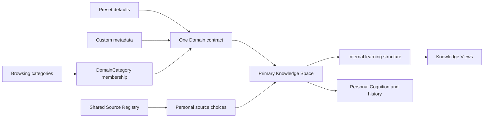

# Domain architecture

Status: ADR-010 is the current product decision. The minimal Python/SQLite foundation is implemented; UI, discovery providers, seeds and knowledge editors remain planned. Field storage is specified in [DATA_CONTRACTS](DATA_CONTRACTS.md), data construction in [DOMAIN_REGISTRY](DOMAIN_REGISTRY.md), and source autonomy in [SOURCE_REGISTRY](SOURCE_REGISTRY.md).

## Four distinct responsibilities

| Concept | Responsibility | Management |
|---|---|---|
| Preset Domain | Broad established knowledge scope, definitions, categories, source recommendations and sparse semantic links | System-maintained versioned defaults; candidate and approved revisions distinguished |
| Custom Domain | Local user-defined scope, including narrow topics, hobbies, games or overlap with a preset | Local user; same Domain schema and downstream services as presets |
| Knowledge Space | Persistent environment for a selected scope: source collection, future conversations, views, questions, explanations and learning history | One primary local space per selected Domain initially |
| Internal knowledge structure | Subdomains, topics, concepts, definitions, evidence and typed knowledge relations | Seed-loaded or progressively proposed after entry; inspectable and revisable |

Origin describes management, not truth, prestige or academic legitimacy. An academic field can be custom; Artificial Intelligence can be a preset despite also relating to Computer Science. Neither a rigid depth nor equal granularity is required across presets. Domain and Knowledge Space are not aliases. An empty space is valid and needs no seed or network access.

Representation, Views and Personal Cognition remain independent layers joined by stable IDs. Conversation-first and structure-first share this infrastructure. The diagram includes planned services; the current implementation does not generate internal knowledge or learning history.

## Registry boundaries

Preset data describes scopes, not a universal detailed knowledge tree. Category and DomainCategory are browsing metadata with many-to-many membership. Membership neither implies SUBDOMAIN_OF nor creates a prerequisite. A Subdomain is normally an internal structure role; only independently justified broad fields become global Domain records. Do not promote every internal node into the catalog.

Four R3 context categories were originally modeled as Domain parents, and R3 topic/concept stubs tested flexibility. Preserve that historical pilot and its IDs/hashes, but exclude records with missing origin from normal discovery until explicitly reclassified. It is not a preset release. Reclassification must append reviewed proposals; never mutate old snapshots or reinterpret their edges in place. New fixtures use separate Category records and no global Topic/Concept hierarchy.

## Domain relation semantics

Edges are independently versioned candidates with provenance and exact-revision reviews. Endpoints must be existing Domain IDs. All self-relations are rejected. Duplicate current edges under different IDs are rejected; edits append revisions. Symmetric edges store sorted endpoints. Classification cycles are rejected in both candidate and effective approved graphs; other types may cycle. None are study sequences.

| Predicate | Meaning from source to target | Symmetric? |
|---|---|---|
| SUBDOMAIN_OF | Source scope is contained in target; requires a scope argument | No; acyclic; multiple parents allowed |
| OVERLAPS_WITH | Scopes share substantive content | Yes |
| DRAWS_ON | Source field draws on target ideas or evidence | No |
| USES_METHODS_FROM | Source field uses methods developed/organized in target | No |
| APPLIES_KNOWLEDGE_FROM | Source scope applies knowledge from target | No |
| RELATED_CONTEXT | Contextual association without containment, dependency or factual support | Yes |
| REFERENCES_PRESET | Custom source scope explicitly references a preset target without copying it | No; custom → preset only |

Legacy RELATED_TO and APPLIES_TO remain readable/replayable. New collection plans use the new vocabulary. Never automatically convert APPLIES_TO into APPLIES_KNOWLEDGE_FROM: direction may be opposite and meaning needs review. Ordinary cross-domain links do not justify new interdisciplinary domains; independent scope and sustained disciplinary identity do.

## Discovery, creation and initialization

Intended workflow: enter name → search local preset/custom labels and aliases → inspect optional suggestions → choose existing or create new → optionally request explicit AI/search metadata proposals → edit/accept local metadata → create custom Domain → open/create primary Knowledge Space → load a compatible approved seed if available, otherwise start empty and grow on demand.

Manual creation needs no remote call. The user supplies definition/scope or explicitly retains a labeled AI proposal; no invented provenance. Duplicate suggestions never block creation or merge objects. Slugs remain unique storage locators; custom creation resolves a collision with a stable ID suffix while preserving the entered name. Initial search is normalized case-insensitive substring matching, not fuzzy identity resolution. No accounts, cross-user matching, global merge service or multi-space UI.

Preset catalog policy: normal browsing uses approved preset revisions. Optional **candidate preview** may show pending presets with visible pending labels and support gaps; rejected, deferred and revised-away records are excluded. A pending replacement never overwrites the approved default. Candidate selection requires explicit opt-in. Custom local use and source acceptance need no registry administrative approval. Legacy origin-unknown records remain accessible through audit tools, not silently classified.

Current LocalDomains supplies local search, manual custom creation, idempotent primary-space creation and source/override persistence. It performs no seed load, network discovery or knowledge generation. Proposal display, preview UI, pagination and full lifecycle screens remain in [custom-domain-lifecycle](../tasks/custom-domain-lifecycle.md).

## Editing and knowledge integrity

| User action | Target store | Must not change |
|---|---|---|
| Move/hide a node | Personal layout configuration | Canonical object or relation |
| Add/reorganize a personal branch | Space learning-structure overlay | Preset defaults/seed |
| Save an explanation | Personal explanation with viewed revision | Professional definition |
| Suggest professional correction | Candidate knowledge revision with evidence/support gaps | Current reviewed knowledge |
| Approve professional revision | Versioned reference knowledge through explicit review | Prior snapshots and personal history |

Remove-from-view is not delete-from-knowledge. IDs survive rearrangement. AI structures remain provisional, editable and source-aware; never introduce deliberate errors as a teaching tactic. Current overrides support only personal display name/scope, stored separately and append-only. Tree/layout/knowledge editors are not implemented. Planned tests cover all five boundaries, hidden-node recovery, stale base versions and rejected revision isolation.

## Outstanding decisions

Later tasks must settle local file sandbox/retention rules, exact seed-readiness evidence, internal Subdomain representation and overlay conflict resolution. None blocks catalog storage or manual custom creation. Keep readiness conservative until a seed service exists. Multi-space management and global identity resolution are intentionally deferred.
